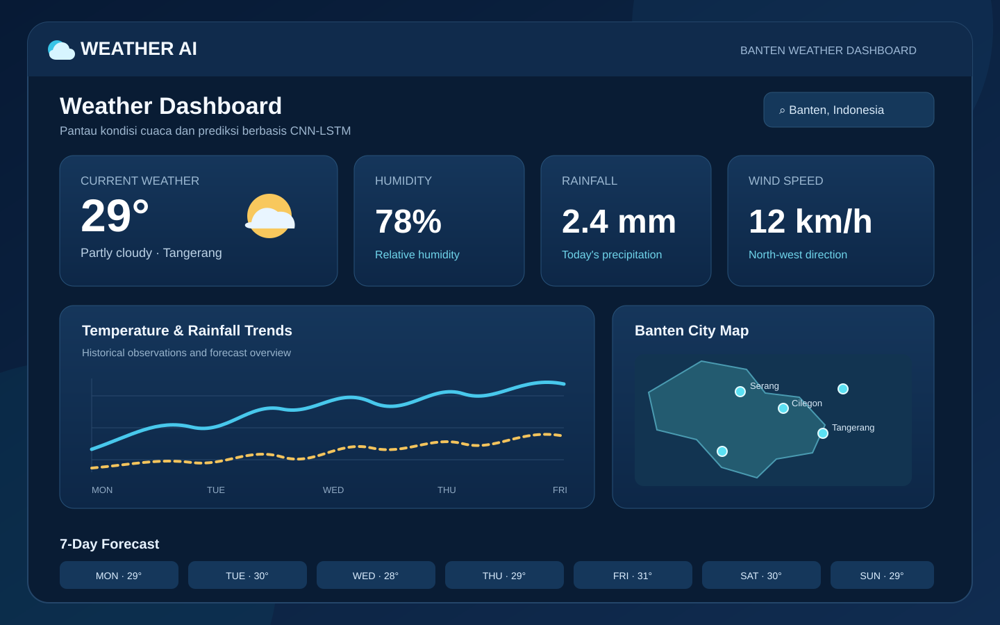

# Weather AI — Banten Weather Forecast Dashboard

A Django-based weather dashboard for Banten, Indonesia. The application combines weather data with a CNN-LSTM time-series model to provide a seven-day temperature and rainfall forecast, an interactive city map, and weather charts.

## Dashboard Preview



> The illustration above previews the dashboard layout. The live application renders actual weather data, map tiles, and forecast outputs when running.

## Features

- Weather dashboard focused on Banten with a city search.
- Interactive Leaflet map with city markers and OpenStreetMap tiles.
- Seven-day historical weather summary and CNN-LSTM forecast.
- Temperature, rainfall, and weather-distribution charts.
- City detail page with hourly forecast and historical weather trends.
- Optional WeatherAPI integration for current conditions and hourly widgets.
- Historical baseline fallback when AI runtime or model artifacts are unavailable.

## Tech Stack

- Python 3.10–3.13 (64-bit)
- Django 5.2
- TensorFlow / Keras
- Pandas, NumPy, scikit-learn, Joblib
- Leaflet, Chart.js, Bootstrap Icons
- Open-Meteo, OpenStreetMap, optional WeatherAPI

## Run Locally (Windows CMD)

Use Python 3.13 or 3.12 (64-bit). Python 3.14 is not in the supported range for the pinned TensorFlow dependency.

1. Create and activate a virtual environment:

   ```cmd
   py -3.13 -m venv .venv
   .venv\Scripts\activate
   ```

2. Install dependencies:

   ```cmd
   python -m pip install --upgrade pip
   pip install -r requirements.txt
   ```

3. Create your local environment file:

   ```cmd
   copy .env.example .env
   ```

   Generate a unique Django secret:

   ```cmd
   python -c "from django.core.management.utils import get_random_secret_key; print(get_random_secret_key())"
   ```

   Set the generated value as `DJANGO_SECRET_KEY` in `.env`. Keep `DJANGO_DEBUG=True` only for local development. Set `WEATHERAPI_API_KEY` to enable the optional WeatherAPI widgets.

4. Initialize the database and check the project:

   ```cmd
   python manage.py migrate
   python manage.py check
   python manage.py test
   ```

5. Start the development server:

   ```cmd
   python manage.py runserver
   ```

6. Visit http://127.0.0.1:8000/.

## Environment Variables

| Variable | Purpose |
| --- | --- |
| `DJANGO_SECRET_KEY` | Private Django signing key. Generate a unique value. |
| `DJANGO_DEBUG` | Set `True` only for local development. |
| `DJANGO_ALLOWED_HOSTS` | Comma-separated hostnames. |
| `WEATHERAPI_API_KEY` | Optional WeatherAPI key for live weather widgets. |

Never commit `.env`, API keys, production secrets, or a local SQLite database.

## Project Structure

```text
.
├── docs/images/             # README dashboard preview
├── forecast/
│   ├── static/css/          # Dashboard styles
│   ├── static/js/           # Map and chart interactions
│   ├── templates/           # Dashboard and city detail pages
│   ├── tests.py
│   ├── urls.py
│   └── views.py
├── weatherProject/          # Django project configuration
├── .env.example
├── .gitignore
├── manage.py
└── requirements.txt
```

## Model and Dataset

The complete project archive contains the historical Banten dataset, model bundle, trained `.keras` model, and original weather images under `data/` and `forecast/static/img/`. Those larger binary assets are not part of the connector-based source upload yet. To add the complete archive to this repository, extract the project ZIP and run `push-to-github.cmd` included in the archive; the script clones this repository first and then pushes the full project contents.

Without those local AI artifacts, the dashboard uses its historical-baseline fallback. CNN-LSTM forecasts require the matching dataset, scaler bundle, and trained model files.

## Production Notes

- Use a strong private secret key, `DJANGO_DEBUG=False`, valid `DJANGO_ALLOWED_HOSTS`, HTTPS, and secure cookies in production.
- The application needs internet access for geocoding, weather services, map tiles, and CDN-hosted frontend libraries.
- Forecast values are model outputs, not guarantees of actual weather. Validate performance on held-out data before operational use.

---

Weather forecasting project focused on Banten, Indonesia.
