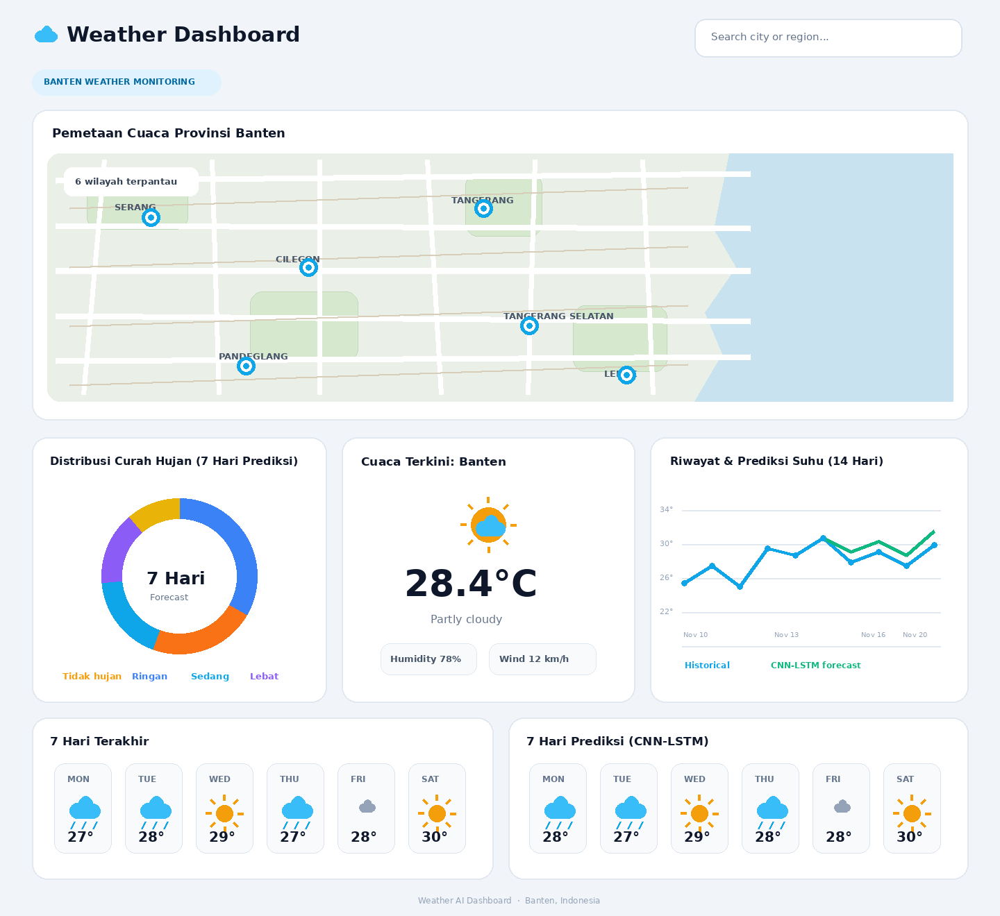

# Weather AI — Banten Weather Forecast Dashboard

A Django-based weather dashboard for Banten, Indonesia. It combines current and historical weather information with a **CNN-LSTM time-series model** to display a seven-day temperature and rainfall prediction, interactive city markers, and weather charts.

## Dashboard Preview



> This is a static visual preview of the dashboard layout using representative values. Live readings, map tiles, and model predictions are generated by the running application and may differ.

## Main Features

- Weather dashboard focused on Banten, with city selection.
- City markers on an interactive Leaflet map using OpenStreetMap tiles.
- Seven-day historical weather summary and seven-day CNN-LSTM forecast.
- Rainfall-category chart calculated from forecast output (no rain, light, moderate, and heavy rain).
- Temperature and rainfall charts, plus a weather distribution chart.
- City detail page with hourly forecast and recent temperature, humidity, and wind charts.
- Historical dataset and trained model artifacts included in `data/`.
- Safe configuration through environment variables; API keys and Django secrets are not stored in source code.

## Technology

- Python 3.10–3.13 (64-bit recommended)
- Django 5.2
- TensorFlow / Keras (CNN-LSTM model inference)
- Pandas, NumPy, scikit-learn, Joblib
- Leaflet, Chart.js, Bootstrap Icons
- Open-Meteo, OpenStreetMap, and optional WeatherAPI integration

## Run on Windows (CMD)

Use Python 3.13 or 3.12 (64-bit) for the pinned TensorFlow release. On native Windows, install the Microsoft Visual C++ Redistributable if needed. This setup uses CPU inference; TensorFlow GPU acceleration on Windows requires WSL2.

1. Create and activate a virtual environment:

   ```cmd
   py -3.13 -m venv .venv
   .venv\Scripts\activate
   ```

2. Install dependencies:

   ```cmd
   python -m pip install --upgrade pip
   pip install -r requirements.txt
   ```

3. Create your local environment file:

   ```cmd
   copy .env.example .env
   ```

   Generate a fresh Django key:

   ```cmd
   python -c "from django.core.management.utils import get_random_secret_key; print(get_random_secret_key())"
   ```

   Put the generated value in `DJANGO_SECRET_KEY`, set `DJANGO_DEBUG=True` for local development, and add a WeatherAPI key to `WEATHERAPI_API_KEY` if you want the current-weather and hourly widgets. Historical data and Open-Meteo-based functions do not require that key.

4. Initialize the local database and run checks:

   ```cmd
   python manage.py migrate
   python manage.py check
   python manage.py test
   ```

5. Start the development server:

   ```cmd
   python manage.py runserver
   ```

6. Open <http://127.0.0.1:8000/>.

## Environment Variables

| Variable | Purpose |
| --- | --- |
| `DJANGO_SECRET_KEY` | Private Django signing key. Generate a unique value before deployment. |
| `DJANGO_DEBUG` | Set `True` only for local development. |
| `DJANGO_ALLOWED_HOSTS` | Comma-separated allowed hostnames. |
| `WEATHERAPI_API_KEY` | Optional key for current weather and hourly data from WeatherAPI. |

Do not commit `.env`, API keys, production secrets, or a local SQLite database.

## Important Notes

- The application needs internet access to retrieve weather/geocoding data, map tiles, and CDN-hosted frontend libraries.
- Without `WEATHERAPI_API_KEY`, current-weather/hourly WeatherAPI widgets are unavailable; the dashboard remains accessible and uses a clearly labeled historical baseline if the CNN-LSTM runtime/model cannot be loaded.
- The seven-day forecast is a model output, not a guarantee of actual weather. Validate model performance with held-out data before operational use.
- For production deployment, set `DJANGO_DEBUG=False`, use a strong secret key, configure allowed hosts and HTTPS, and run Django's deployment checks.

---

Made for a Banten weather forecasting project.
